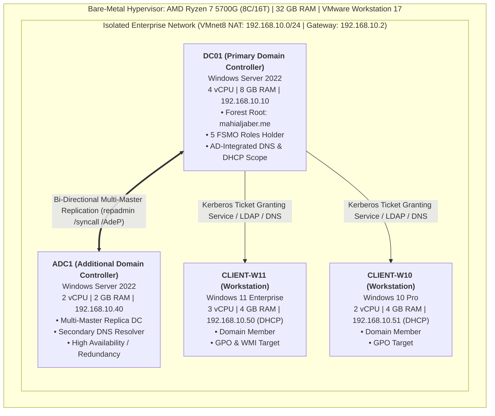
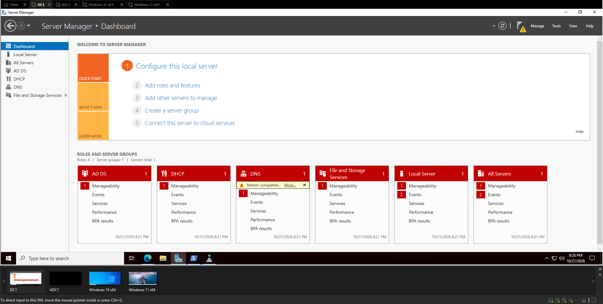
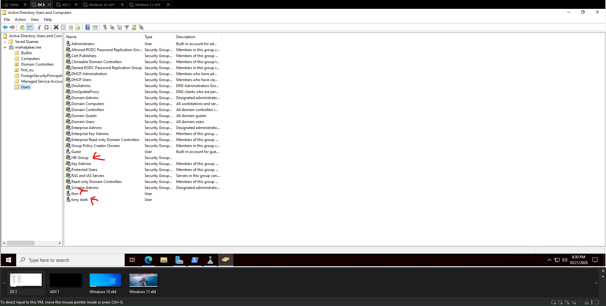
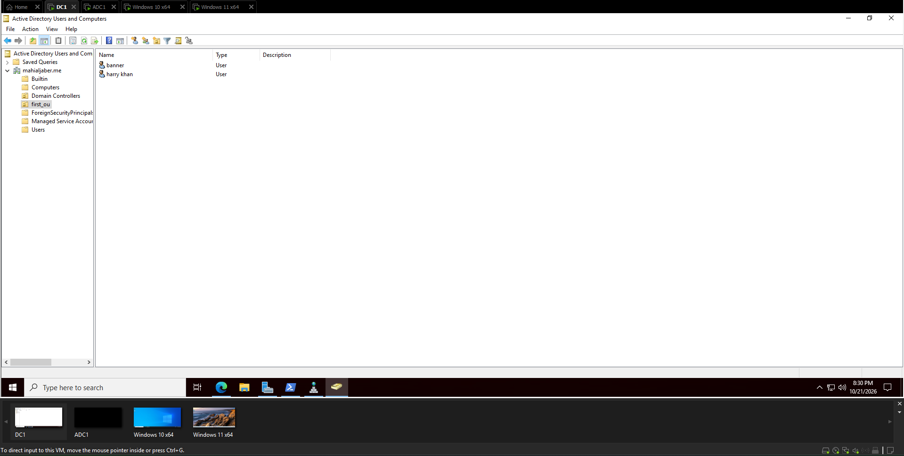
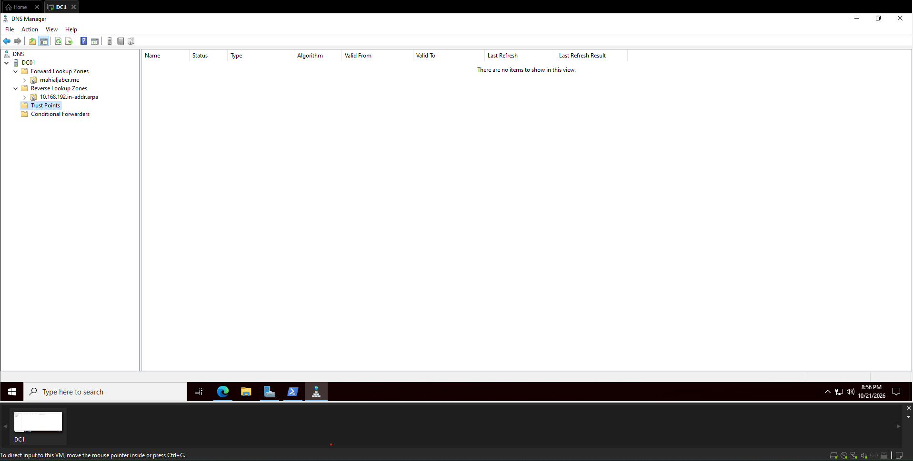
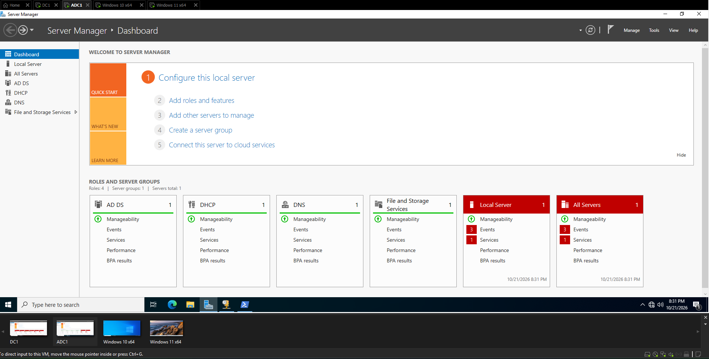
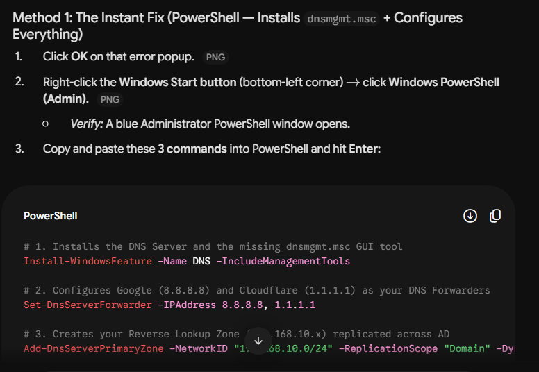
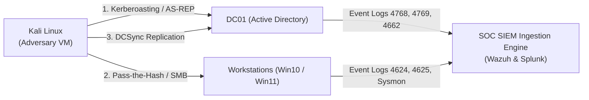

# Enterprise Active Directory Infrastructure & SOC Threat Detection Lab

[](#)
[](#)
[](#)
[](#)
[](#)
[](#)

---

## Executive Summary

This repository documents the design, deployment, configuration, and verification of an **Enterprise Active Directory Domain Services (AD DS) Infrastructure** built on **Windows Server 2022** and **VMware Workstation Pro**. 

Constructed from the perspective of an **Information Security & SOC Analyst**, this project moves beyond standard administrative tasks to establish an enterprise-grade identity fabric (`mahialjaber.me`). It incorporates high availability through an **Additional Domain Controller (ADC)**, automated IP provisioning via **DHCP**, secure **Active Directory-Integrated DNS**, hardened **Group Policy Objects (GPOs)** with **WMI filtering**, and comprehensive **Advanced Audit Policies** aligned with **MITRE ATT&CK** detection engineering requirements.



---

## Lab Architecture & Technical Specifications

### 1. Hardware & Virtualization Matrix

* **Physical Hypervisor Host:** AMD Ryzen 7 5700G (8 Cores, 16 Threads, up to 4.6 GHz)
* **Physical RAM:** 32 GB DDR4 (29.95 GB accessible)
* **Hypervisor Platform:** VMware Workstation Pro 17
* **Virtual Switching:** VMnet8 Custom NAT Subnet (`192.168.10.0/24`)

| Hostname | Role in Architecture | Operating System | vCPU | RAM | IP Assignment | IPv4 Address | DNS Resolvers |
| :--- | :--- | :--- | :---: | :---: | :---: | :---: | :---: |
| **`DC01`** | Forest Root Domain Controller | Windows Server 2022 | 4 | 8,192 MB | **Static** | `192.168.10.10` | `127.0.0.1`, `192.168.10.10` |
| **`ADC1`** | Additional Domain Controller | Windows Server 2022 | 2 | 2,048 MB | **Static** | `192.168.10.40` | `192.168.10.10`, `127.0.0.1` |
| **`CLIENT-W11`** | Domain Workstation (Windows 11) | Windows 11 Enterprise | 3 | 4,096 MB | **DHCP (Auto)**| `192.168.10.50` | `192.168.10.10` |
| **`CLIENT-W10`** | Domain Workstation (Windows 10) | Windows 10 Pro | 2 | 4,096 MB | **DHCP (Auto)**| `192.168.10.51` | `192.168.10.10` |

---

## Core Engineering Implementations

### 1. Primary Domain Controller Promotion (`DC01`)
* Initialized a brand new forest root domain: `mahialjaber.me`.
* Elevated Domain and Forest Functional Levels to **Windows Server 2016** (standard maximum in Windows Server 2022).
* Configured core Active Directory databases (`NTDS.dit`, transaction logs, `edb.chk`) and `SYSVOL` replication directories.
* Configured emergency Directory Services Restore Mode (DSRM) credentials.


*Figure 1: Windows Server 2022 Server Manager on `DC01` showing active AD DS, DNS, DHCP, and File & Storage Services.*

---

### 2. Identity & Access Management (IAM) & OU Hierarchy
* Created a clean Organizational Unit (`OU`) structure separating functional departments, service accounts, and workstation assets.
* Provisioned domain user accounts with User Principal Names (`UPN`):
  * `harry@mahialjaber.me`
  * `banner@mahialjaber.me`
  * `khan@mahialjaber.me`
  * `tony_stark@mahialjaber.me`
* Established role-based access control (RBAC) via the **AGDLP rule** (*Accounts $\rightarrow$ Global Groups $\rightarrow$ Domain Local Groups $\rightarrow$ Permissions*), creating specialized security groups such as `HR-Group`.


*Figure 2: Active Directory Users and Computers (`dsa.msc`) showcasing domain tree `mahialjaber.me` and custom Security Groups.*


*Figure 3: Population of provisioned user objects inside the custom `first ou` departmental container.*

---

### 3. Active Directory-Integrated DNS & DHCP Scopes
* **Forward Lookup Zone:** `mahialjaber.me` configured with **Secure Dynamic Updates** to prevent unauthorized record poisoning.
* **Reverse Lookup Zone:** `10.168.192.in-addr.arpa` configured across the `/24` subnet to ensure Kerberos mutual authentication and reverse IP lookups.
* **Public Forwarders:** Configured Cloudflare (`1.1.1.1`) and Google (`8.8.8.8`) upstream recursive forwarders.
* **DHCP Scope:** Provisioned range `192.168.10.50` - `192.168.10.254` with Option 003 (Gateway `192.168.10.2`), Option 006 (DNS `192.168.10.10`), and Option 015 (Domain Name `mahialjaber.me`), authorized in AD.


*Figure 4: DNS Manager console verifying Active Directory-Integrated Forward and Reverse (`10.168.192.in-addr.arpa`) Lookup Zones.*

---

### 4. High Availability: Additional Domain Controller (`ADC1`)
* Deployed a second Windows Server 2022 VM to eliminate Single Points of Failure (SPOF).
* Promoted `ADC1` as a replica Domain Controller in the existing `mahialjaber.me` domain.
* Validated multi-master replication rings using `repadmin /syncall /AdeP` and verified directory health via `dcdiag /test:replications`.


*Figure 5: Server Manager on `ADC1` confirming secondary Domain Controller status and operational health.*

---

### 5. Group Policy Objects (GPO) & WMI Query Filtering
* Implemented the **LSDOU Precedence Model** (*Local $\rightarrow$ Site $\rightarrow$ Domain $\rightarrow$ Parent OU $\rightarrow$ Child OU*).
* Created **Windows Management Instrumentation (WMI)** filters to dynamically scope policies based on OS architecture:
  * **Target Windows 11 Workstations Exclusively:**
    ```sql
    SELECT * FROM Win32_OperatingSystem WHERE Version LIKE "10.0.22%" AND ProductType = "1"
    ```
  * **Target All 64-Bit Desktop Workstations (Exclude Domain Controllers):**
    ```sql
    SELECT * FROM Win32_OperatingSystem WHERE Version LIKE "10.0%" AND ProductType = "1" AND OSArchitecture = "64-bit"
    ```

---

### 6. Flexible Single Master Operations (FSMO) Management
Audited and tested role transfers across the 5 authoritative single-master roles:
1. **Schema Master** (Forest-Wide)
2. **Domain Naming Master** (Forest-Wide)
3. **PDC Emulator** (Domain-Wide - NTP Source & Password Sync)
4. **RID Master** (Domain-Wide - Relative ID Pool Allocator)
5. **Infrastructure Master** (Domain-Wide - Cross-Domain Object Sync)

```cmd
:: Quick verification command
netdom query fsmo
```

FSMO migration and failover workflows were verified both via PowerShell (`Move-ADDirectoryServerOperationMasterRole`) and command-line (`ntdsutil`).

---

## Real-World Troubleshooting & Engineering Fixes

During the deployment process, real infrastructure challenges occurred. Rather than starting over, root causes were diagnosed and remediated:

### Case Study: Missing DNS Management MMC Console (`dnsmgmt.msc`)
* **Problem:** Server Manager failed to link the graphical DNS console, generating MMC snap-in initialization errors.
* **Root Cause:** The graphical management binaries (`RSAT-DNS-Server`) were omitted during the initial role installation.
* **Resolution:** An automated PowerShell script was created to install the missing RSAT tools, configure recursive DNS forwarders, and bind the reverse lookup zone in one execution:

```powershell
# Automated PowerShell Hotfix
Install-WindowsFeature -Name DNS -IncludeManagementTools
Set-DnsServerForwarder -IPAddress 8.8.8.8, 1.1.1.1
Add-DnsServerPrimaryZone -NetworkID "192.168.10.0/24" -ReplicationScope "Domain" -DynamicUpdate "Secure"
```


*Figure 6: Automated DNS remediation procedure executed via Administrator PowerShell.*

---

## Active Directory Command Cheat Sheet

| Command / Tool | Execution Context | Operational Purpose |
| :--- | :--- | :--- |
| `repadmin /replsummary` | Admin CMD / DC | Summary status of inbound/outbound replication health across all DCs. |
| `repadmin /syncall /AdeP` | Admin CMD / DC | Forces immediate forest-wide synchronization across all partitions. |
| `dcdiag /test:replications`| Admin CMD / DC | Deep diagnostic test for broken replication links or RPC timeouts. |
| `netdom query fsmo` | Admin CMD / DC | Discovers which DCs currently hold each of the 5 FSMO roles. |
| `gpupdate /force` | Client / DC CMD | Forces an immediate refresh and application of Group Policy Objects. |
| `gpresult /r` | Admin CMD | Displays Applied GPOs, Denied GPOs, and security group memberships. |
| `gpresult /h report.html` | Admin CMD | Exports an in-depth HTML diagnostic audit of winning GPO settings. |
| `nslookup -type=SRV ...` | Client / DC CMD | Validates critical Active Directory Kerberos and LDAP SRV records. |

---

## The SOC Analyst Perspective: Threat Detection Blueprint

As a SOC Analyst, understanding normal Active Directory mechanics is the prerequisite to hunting domain attacks. This lab is architected to generate telemetry for detecting top adversary techniques from the **MITRE ATT&CK Matrix**:



### Critical Security Event IDs Monitored

| Event ID | Event Description | Threat Vector / MITRE Technique | Detection Significance |
| :---: | :--- | :--- | :--- |
| **`4768`** | Kerberos TGT Requested | **AS-REP Roasting** (T1558.004) | Flags accounts where Kerberos Pre-Authentication is disabled (`PreAuthType=0`). |
| **`4769`** | Kerberos TGS Requested | **Kerberoasting** (T1558.003) | Detects bulk requests for RC4-encrypted service tickets (`TicketEncryptionType=0x17`). |
| **`4771`** | Kerberos Pre-Auth Failed | **Password Spraying** (T1110.003) | Multiple failures across different accounts originating from the same workstation IP. |
| **`4624`** | Successful Account Logon | **Lateral Movement** (T1021.002) | Tracks Logon Type 3 (Network) and Type 10 (RemoteInteractive/RDP). |
| **`4625`** | Failed Account Logon | **Brute Force** (T1110.001) | SubStatus `0xC000006A` indicates bad password; `0xC0000072` indicates disabled account. |
| **`4672`** | Special Privileges Assigned | **Privilege Escalation** (T1078) | Logs whenever `Administrator` or privileged security principals authenticate. |
| **`4720`** | User Account Created | **Persistence** (T1136.002) | Alerts on unauthorized account creation outside scheduled change windows. |
| **`4728`** | Member Added to Security Group| **Privilege Escalation** (T1098) | High-severity alert when a user is added to `Domain Admins` or `Enterprise Admins`. |
| **`4662`** | Directory Service Object Access | **DCSync Attack** (T1003.006) | Flags replication rights requests (`DS-Replication-Get-Changes-All`) from non-DC accounts. |

---

## Repository Structure

```
enterprise-ad-soc-lab/
├── assets/
│   └── images/                       # High-resolution cropped visual proofs
│       ├── 01_server_manager_dc01.png
│       ├── 02_aduc_domain_hierarchy.png
│       ├── 02b_aduc_first_ou_users.png
│       ├── 03_dns_forward_reverse_zones.png
│       ├── 04_adc01_replication_node.png
│       ├── 05_dns_powershell_recovery.png
│       ├── 06_gpo_precedence_cheat_sheet.png
│       └── 07_fsmo_roles_architecture.png
├── docs/                             # In-depth architectural documentation
│   ├── 01_architecture_and_topology.md
│   ├── 02_installation_and_promotion_guide.md
│   ├── 03_dns_and_dhcp_design.md
│   ├── 04_group_policy_and_wmi_filters.md
│   ├── 05_fsmo_roles_and_replication.md
│   └── 06_soc_threat_monitoring_blueprint.md
├── gpo/                              # Group Policy baselines and filters
│   ├── auditing-baseline.md          # Advanced Audit Policy Configuration
│   └── wmi-filters/
│       ├── windows11_only.wql        # WQL query for Windows 11 targeting
│       └── workstations_64bit.wql    # WQL query for 64-bit clients
├── scripts/                          # Automated PowerShell deployment scripts
│   ├── 01_Configure-Network-DC01.ps1 # Static IP and DNS configuration
│   ├── 02_Deploy-ADDS-Forest.ps1     # Automated forest promotion
│   ├── 03_Configure-DNS-and-DHCP.ps1 # Reverse lookup zone and DHCP scope
│   ├── 04_Deploy-ADC1-Replication.ps1# Secondary DC deployment
│   ├── 05_Manage-FSMO-Roles.ps1      # FSMO audit and migration utility
│   └── 06_AD-Health-Check.ps1        # Deep diagnostic verification
├── troubleshooting/
│   └── field_playbook_issues_and_fixes.md # Real failure logs and resolutions
├── .gitignore
├── LICENSE                           # MIT License
└── README.md
```

---

## Future Roadmap (Phase 2)

* [ ] **Wazuh SIEM Ingestion:** Deploy the Wazuh Agent on `DC01` and client endpoints to forward Windows Security logs to the Wazuh Manager (Rocky Linux).
* [ ] **Splunk Universal Forwarder Integration:** Configure `inputs.conf` and `outputs.conf` on `DC01` to stream Active Directory logs to Splunk Enterprise (Ubuntu).
* [ ] **Adversary Emulation:** Execute Kerberoasting and AS-REP Roasting simulations from Kali Linux against `mahialjaber.me` and develop production Sigma/Splunk detection queries.

---

## Author & Acknowledgments

* **Mahi Al Jaber** — *SOC Analyst & Detection Engineer*  
* **GitHub:** [@mahialjaber](https://github.com/mahialjaber)  
* **Domain:** `mahialjaber.me`  
* Special credit to Manjeet Rawat (*Teach Me Cloud*) for the comprehensive Windows Server 2022 Active Directory curriculum.

---
*Distributed under the MIT License. See [LICENSE](LICENSE) for details.*
