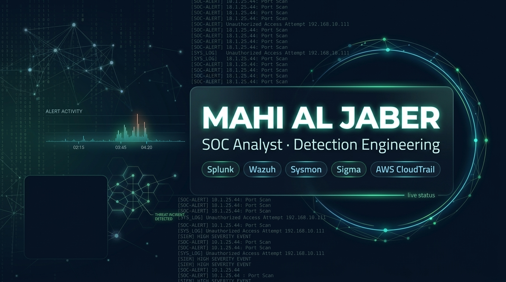
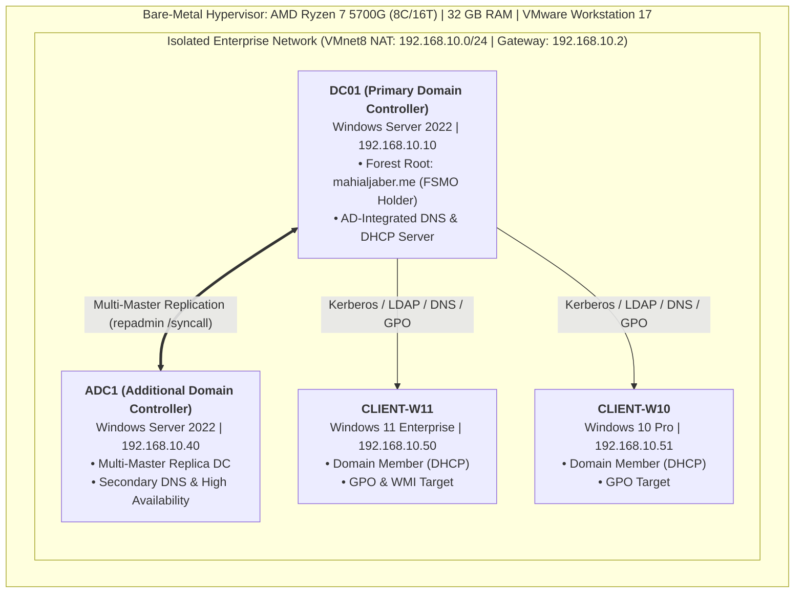

<div align="center">



# 🛡️ Enterprise Active Directory Infrastructure & SOC Threat Detection Lab
### *Production Windows Server 2022 Forest, High Availability, DNS/DHCP, GPO Hardening & Telemetry*

[](#)
[](#)
[](#)
[](#)
[](#)
[](https://github.com/mahialjaber)

</div>

---

## Executive Overview

An enterprise-grade **Active Directory Domain Services (AD DS)** environment built on **Windows Server 2022** and **VMware Workstation Pro**. Designed from a **SOC Analyst & Detection Engineer** perspective, this lab implements high availability via an **Additional Domain Controller (ADC)**, **AD-Integrated DNS/DHCP**, hardened **GPOs with WMI filtering**, and comprehensive **Advanced Audit Policies** mapped to **MITRE ATT&CK** threat detection requirements.



---

## Lab Architecture & Node Specifications

| Hostname | Role in Architecture | OS Version | Hardware Specs | IP Address | Network Assignment |
| :--- | :--- | :--- | :---: | :---: | :---: |
| **`DC01`** | Primary Domain Controller (FSMO, DNS, DHCP) | Windows Server 2022 | 4 vCPU / 8 GB RAM | `192.168.10.10` | Static |
| **`ADC1`** | Additional Domain Controller (Replica, DNS) | Windows Server 2022 | 2 vCPU / 2 GB RAM | `192.168.10.40` | Static |
| **`CLIENT-W11`** | Domain Workstation (Windows 11) | Windows 11 Enterprise | 3 vCPU / 4 GB RAM | `192.168.10.50` | DHCP (Option 003/006/015) |
| **`CLIENT-W10`** | Domain Workstation (Windows 10) | Windows 10 Pro | 2 vCPU / 4 GB RAM | `192.168.10.51` | DHCP (Option 003/006/015) |

---

## Visual Proofs & Core Implementations

### 1. Forest Root & Identity Management
Promoted forest root `mahialjaber.me`, provisioned departmental OUs (`first ou`), created user accounts (`harry`, `banner`, `khan`), and established RBAC security groups (`HR-Group`) following the **AGDLP** methodology.


*Figure 1: Windows Server 2022 Server Manager on `DC01` displaying active AD DS, DNS, DHCP, and File/Storage services.*


*Figure 2: Active Directory Users and Computers (`dsa.msc`) showcasing domain tree `mahialjaber.me` and custom Security Groups.*

---

### 2. Network Services & High Availability
* **Active Directory-Integrated DNS:** Forward zone `mahialjaber.me` with Secure Dynamic Updates and reverse lookup zone `10.168.192.in-addr.arpa`.
* **DHCP Scope:** Dynamic pool `192.168.10.50`–`254` authorized in AD with Option 003 (Gateway), 006 (DNS), and 015 (Domain Name).
* **Fault Tolerance (ADC1):** Promoted a secondary Domain Controller to eliminate single points of failure with multi-master directory synchronization.


*Figure 3: DNS Manager console verifying Active Directory-Integrated Forward and Reverse (`10.168.192.in-addr.arpa`) Lookup Zones.*


*Figure 4: Server Manager on `ADC1` confirming secondary Domain Controller promotion and operational health.*

---

## Engineering Highlights & Field Troubleshooting

### Automated DNS Snap-in Recovery
When the graphical DNS MMC console (`dnsmgmt.msc`) failed to initialize due to missing management sub-features, the issue was remediated via PowerShell:

```powershell
# Installs missing RSAT DNS tools, upstream forwarders, and reverse lookup zone
Install-WindowsFeature -Name DNS -IncludeManagementTools
Set-DnsServerForwarder -IPAddress 8.8.8.8, 1.1.1.1
Add-DnsServerPrimaryZone -NetworkID "192.168.10.0/24" -ReplicationScope "Domain" -DynamicUpdate "Secure"
```

### Precision WMI Query Filtering
Scoped Group Policies dynamically to prevent desktop baseline policies from applying to Domain Controllers:
```sql
-- Target 64-bit Workstations (skipping Domain Controllers & Member Servers)
SELECT * FROM Win32_OperatingSystem WHERE Version LIKE "10.0%" AND ProductType = "1" AND OSArchitecture = "64-bit"
```

---

## SOC Threat Detection Blueprint

Configured Advanced Audit Policies on `DC01` to capture critical telemetry for detection engineering:

| Attack Vector | MITRE ATT&CK | Monitored Event ID | Detection Logic |
| :--- | :--- | :---: | :--- |
| **Kerberoasting** | T1558.003 | **`4769`** | Bulk RC4-encrypted (`0x17`) service tickets requested for accounts with SPNs. |
| **AS-REP Roasting** | T1558.004 | **`4768`** | Kerberos TGT requested without pre-authentication (`PreAuthType=0`). |
| **DCSync Attack** | T1003.006 | **`4662`** | Replication access (`DS-Replication-Get-Changes-All`) requested by a non-DC account. |
| **Privilege Escalation**| T1098 / T1078 | **`4728`, `4732`** | Member added to privileged groups (`Domain Admins`, `Enterprise Admins`). |
| **Lateral Movement** | T1021.002 | **`4624`** | NTLM/Kerberos network authentication (Logon Type 3) across internal hosts. |
| **Brute Force / Spray** | T1110.001 | **`4625`, `4771`** | Multiple authentication failures originating from a single source workstation. |

---

## Health Diagnostic Tool

A dedicated diagnostic script is available at [`scripts/AD-Health-Check.ps1`](scripts/AD-Health-Check.ps1) to validate replication health, DCDIAG test suites, and SYSVOL availability in one execution:

```powershell
# Run from an elevated PowerShell session on DC01 or ADC1
.\scripts\AD-Health-Check.ps1
```

---

## Documentation Deep Dives

Detailed architectural guides and playbooks are maintained in dedicated modules:

* 📐 [Architecture & Network Topology](docs/01_architecture_and_topology.md)
* 🚀 [Installation & Domain Controller Promotion Guide](docs/02_installation_and_promotion_guide.md)
* 🌐 [DNS & DHCP Architecture Design](docs/03_dns_and_dhcp_design.md)
* ⚙️ [Group Policy Infrastructure & WMI Filtering](docs/04_group_policy_and_wmi_filters.md)
* 🔄 [FSMO Roles Architecture & Replication Health](docs/05_fsmo_roles_and_replication.md)
* 🛡️ [SOC Threat Monitoring & Event ID Blueprint](docs/06_soc_threat_monitoring_blueprint.md)
* 🛠️ [Field Troubleshooting Playbook & Incident Logs](troubleshooting/field_playbook_issues_and_fixes.md)
* 📋 [Enterprise Security Auditing Baseline](gpo/auditing-baseline.md)

---

## Next Step
* Next Phase: Ingesting Active Directory event logs into Splunk & Wazuh SIEM for detection engineering.

---

## Author

* **Mahi Al Jaber** — *SOC Analyst & Detection Engineer* ([@mahialjaber](https://github.com/mahialjaber))
* **Domain:** `mahialjaber.me`

---
*Distributed under the MIT License. See [LICENSE](LICENSE) for details.*
